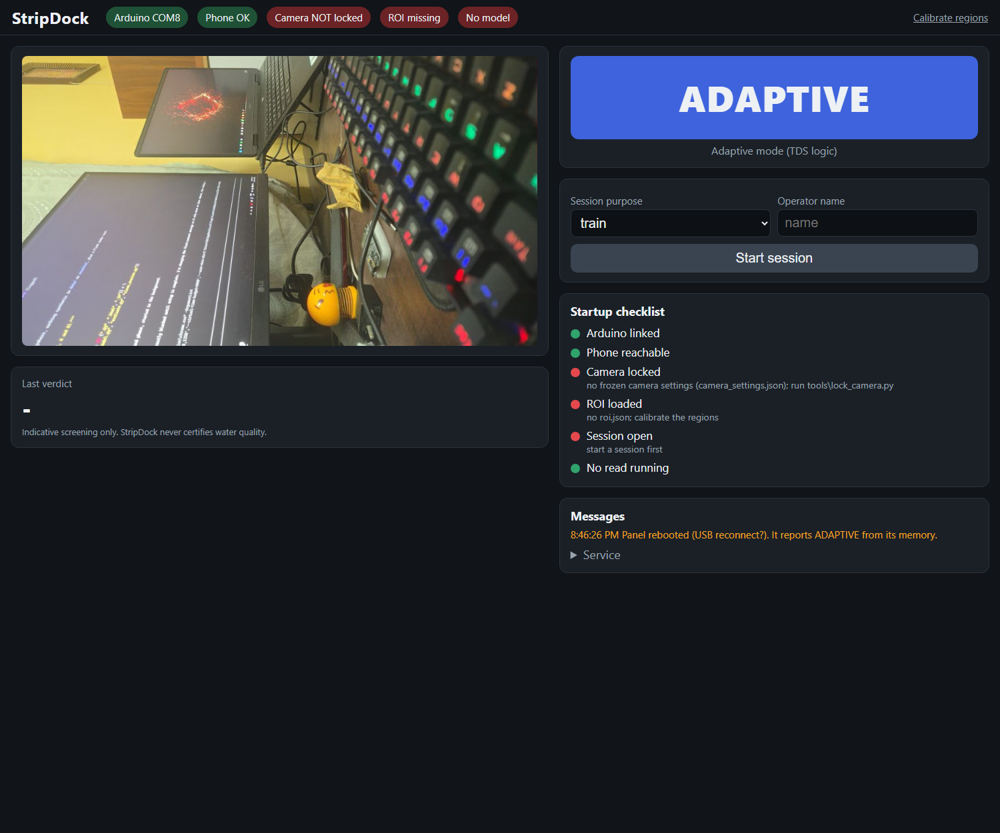
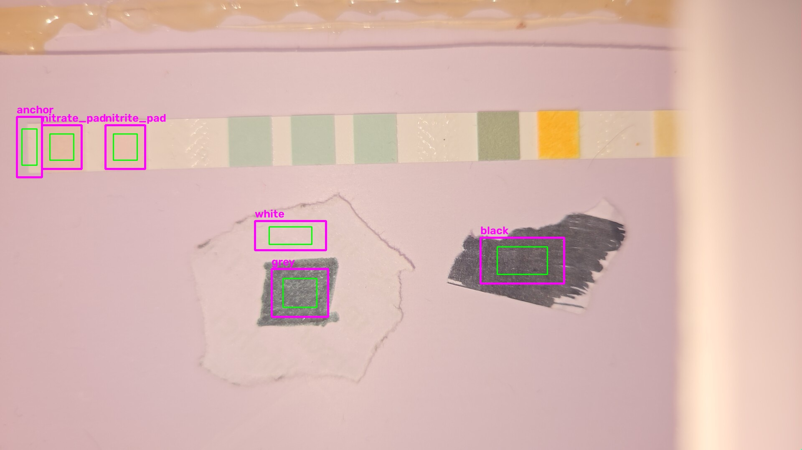

# StripDock RUNBOOK (Round 3)

For the team operating StripDock. No coding needed. Do the steps in order and don't skip any.
Commands are typed into **PowerShell**, opened in the folder `C:\stripdock_r3` (in File Explorer, open the folder, click the address bar, type `powershell`, press Enter).

> StripDock is **indicative screening**. It never says water is safe. On screen it only ever shows **HOLD: RO+UV**, **Adaptive mode (TDS logic)** or **UNKNOWN: re-test**.

**Words used here**

- **Panel**: the Arduino board with the small screen (OLED), the amber HOLD LED, the green CONFIRM LED and the **CONFIRM push button**.
- **CONFIRM button**: the physical push button on the panel. It is not anything on the computer.
- **Tray**: the sliding part of the dock where the strip goes. The white, grey and black **reference patches** are glued to the tray floor. Never move them.
- **Read**: one strip measured by the app (about 66 s).



---

## 1. Start of day

1. Plug the panel's USB cable into the PC. Within a few seconds the panel screen shows the StripDock panel.
2. Close the **Arduino IDE** if it is open. Its Serial Monitor blocks the panel ("COMx is in use ... Access is denied").
3. Connect the phone to the PC with its **USB cable** (USB debugging on; accept *Allow USB debugging* once). On the phone, open **IP Webcam** and tap **Start server**. The app reaches it over the cable (`adb forward`, `phone_ip: 127.0.0.1`), so Wi-Fi is not used (DECISIONS D-36).
4. Lay the phone screen-up on the dock lid in its marked place, with the back camera over the hole. Don't move it after this.
5. Re-apply the camera lock (this also turns the torch on):
   ```
   .venv\Scripts\python tools\lock_camera.py
   ```
   It must end with **LOCK VERIFIED**. If it says LOCK NOT VERIFIED, see Troubleshooting.
6. Start the app: double-click `start_app.bat`, or run
   ```
   .venv\Scripts\python run_app.py
   ```
   The browser opens http://localhost:5000.
7. Look at the **Startup checklist** on the right. Every line must be green before START works. If a line is red, the reason is written under it:
   - *Arduino linked*: USB cable, or the Arduino IDE is still open.
   - *Phone reachable*: IP Webcam not running, phone USB cable out, or USB debugging not allowed.
   - *Camera locked*: run step 5 again.
   - *ROI loaded*: the regions are not calibrated (step 3).
   - *Model frozen* (test, degraded and demo only): see step 5.
8. The panel screen's bottom line must say **Link OK** while the app runs. LINK LOST appears whenever the app is closed; that is normal.

## 2. Lock the camera (only once, or when the phone, patches or lighting change)

The camera is **already locked** (re-locked 2026-11-22 12:11 on the new laptop, settings hash `231eb85694496d11`, the same settings as 20 Nov). Don't redo this after training has started, because the model belongs to these settings.

If it must be redone (before any training):
1. Strip in the tray, drawer closed, phone in place.
2. Run:
   ```
   .venv\Scripts\python tools\lock_camera.py --new
   ```
   This takes 1–2 minutes. It sets 1920×1080, JPEG quality 90, night vision off, HDR off, flash off, torch on, then locks focus, white balance and exposure, and checks colour stability. It must end with **LOCK VERIFIED**.
3. Then recalibrate the regions (step 3) and run:
   ```
   .venv\Scripts\python tools\lock_camera.py --new
   .venv\Scripts\python tools\lock_camera.py --refresh-focus-ref
   ```
   The second `--new` aims the exposure at the real white patch.

To check at any time: `.venv\Scripts\python tools\lock_camera.py --check`.

**If the phone does not accept a setting over Wi-Fi**, the tool prints a MANUAL STEP. Do it in IP Webcam → *Video preferences* (manual sensor / fixed exposure, white balance preset, focus mode), then run `--check`.

## 3. Calibrate the regions (ROI)

Do this **only** when the tray, phone, patches or lid have moved. **After training starts, never**, because a new ROI invalidates the model (the app will refuse test mode).

The regions are calibrated for the layout of 2026-11-22 12:10 (ROI hash `01396f4470cc9a85`, new laptop). **If the box or phone has moved since (e.g. after transport), recalibrate.**



To recalibrate:
1. In the app, click **Calibrate regions** (top right).
2. Take the strip out, slide the tray in **empty**, and click **1. Capture EMPTY tray**.
3. Put a dry strip in its fixed spot against the end-stop, slide the tray in, and click **2. Grab frame with strip**.
4. For each button (**nitrate_pad, white, grey, black**, and optionally **nitrite_pad** and **anchor**): click it, then drag a rectangle on the picture **inside** that pad or patch. Keep away from edges, glossy spots and torn paper edges. The dashed inner box is what gets measured.
   - *anchor*: a small box around the strip **tip** only (strip end and background), not over the nitrate pad.
5. Click **Save**.
6. Run `.venv\Scripts\python tools\lock_camera.py --refresh-focus-ref`.

## 4. Dry runs and quality thresholds (before training)

These set the quality-gate thresholds from real captures. Every verdict here will be **UNKNOWN: re-test**; that is expected.

1. In the app: Session purpose **dry**, type your name, click **Start session**.
2. Do these reads. For each one: strip in place, drawer closed, type the code and the note, press **START**, wait for the verdict (about 66 s).

   | Codes | Note | What goes in the tray |
   |---|---|---|
   | E1, E2, E3 | `empty` | nothing (empty tray) |
   | D1, D2, D3 | `dry` | a dry, undipped strip |
   | W1, W2, W3 | `distilled` | a NEW strip, dipped 1 s in distilled water, edge blotted |
   | T1, T2, T3 | `tap` | a NEW strip, dipped 1 s in tap water, edge blotted |
3. Click **Close session**.
4. Close the app (Ctrl+C in its window). Then run:
   ```
   .venv\Scripts\python tools\suggest_thresholds.py
   ```
   Read the table. If it looks sensible, apply it:
   ```
   .venv\Scripts\python tools\suggest_thresholds.py --apply
   ```
5. Run the HIL fail-safe steps 4–6 (section 10, "HIL check").
6. The distilled-water reads may be used as **0 mg/L blanks** in training only if the team agrees (`train.py --include-dry-blanks`).

The thresholds are **frozen** when the model is frozen. Never change `config.yaml` after that.

## 5. Training session

Standards: **0, 10, 25, 35, 45, 55, 100 mg/L NO₃⁻** (nitrate ion, the bottle's unit), **2 strips each** (14 reads, codes `S<level>-A` / `S<level>-B`), in the randomised order of `data/labels/collection_plan_20261122.csv` (DECISIONS D-41). Each level in its own rinsed cup. Use strips from the same bottle lot (7833).

1. The chemistry person fills `data\labels\train_labels.csv` (columns: `sample_id, concentration_mg_L, standard_batch, strip_lot, tds_ppm, made_by, date`).
2. In the app: purpose **train**, your name, **Start session**.
3. For each strip:
   1. Type the sample code exactly as in `train_labels.csv` (e.g. `S25-2`).
   2. Type the known concentration (mg/L NO₃⁻).
   3. Dip the strip 1 s, blot the edge on a tissue, put it in the tray against the end-stop, close the drawer, and press **START** at once. The 60 s timer starts at START.
   4. Don't touch the dock until the verdict shows.
4. Mix the order: don't do all the 0s first.
5. Click **Close session**.

## 6. Train and freeze the model

Close the app first. Then:
```
.venv\Scripts\python train.py
.venv\Scripts\python freeze_model.py
```
- `train.py` refuses to run if the camera lock check fails or the ROI or camera changed since the training session. It writes `models\model_card.md` (read it) and `results\fig_training_curve.png`.
- `freeze_model.py` makes the model read-only, records its fingerprint (SHA-256), and also freezes the thresholds, ROI and camera settings.
- After freezing: **don't recalibrate, re-lock with `--new`, or edit `config.yaml`.**

## 7. Blind test session

The chemistry person prepares coded samples and writes `data\labels\test_answer_key.csv` (`sample_id, true_concentration_mg_L, type, tds_ppm`, where type = `spiked_tap | compliant | unseen_standard | conservative`). **Operators must not see it.** The app never reads it.

1. Start the app. Session purpose **test** (it refuses to open if the model is not frozen or something changed since freezing).
2. For each coded sample: type the code, dip, blot, tray in, **START**, wait for the verdict.
3. If the verdict is UNKNOWN, you may re-test the same code with a new strip; both reads are kept.
4. If the panel asks **"Press CONFIRM on the panel within 60 s"**, follow the team's test protocol: during scored tests, pressing CONFIRM is the operator's decision to accept the PASS.
5. Click **Close session**. This locks the folder (read-only + `MANIFEST.sha256`).
6. Baselines: for the 30 unseen standards, a person reads each strip by eye against the bottle chart at 60 s, and from a plain phone photo, without seeing StripDock's result. Record both in `data\labels\baseline_readings.csv` (copy `baseline_readings_TEMPLATE.csv`).

## 8. Degraded session

1. Purpose **degraded**. For each read, pick the degradation in the drop-down **before** START, and do it:
   - `drawer_open`: open the drawer a few cm during the countdown.
   - `torch_through_seam`: shine a torch at a seam of the box during the countdown.
   - `blur`: smear a little water on the lid window, or lift the phone slightly.
   - `early_read`: nothing to do; the app reads at 20 s on purpose.
   - `no_strip`: empty tray.
   - `phone_moved`: nudge the phone by about 1 cm before START.
2. About 30 reads in total, mixed. Then **Close session**.
3. Put the phone back exactly in place and run `tools\lock_camera.py --check` before any further scored reads.

## 9. Evaluate

Close the app. Then:
```
.venv\Scripts\python evaluate.py
```
It reads only the frozen model, only **closed** sessions, and the answer key. It writes `results\round3_results.md`, CSVs and figures. The numbers for the report are in `results\report_numbers.md` (update it from the results file).

If a bug is found after testing, fix it, then run `evaluate.py --tag fixed_<what>`. Both versions stay; report both, labelled.

## 10. Demo for filming

1. Start of day (section 1). Open a **demo** session.
2. **Normal read**: a spiked sample → **HOLD: RO+UV** (panel goes HOLD, amber LED on).
3. **Clear the hold**: read a compliant sample → PASS → the app says *Press CONFIRM on the panel within 60 s*, the green LED lights → press the physical **CONFIRM button** → the panel and app show **Adaptive mode (TDS logic)**.
4. **Fail-safe: drawer pulled**: start a read, pull the drawer open during the countdown → **UNKNOWN: re-test** (light leak). The hold is not cleared.
5. **Fail-safe: USB pulled**: pull the panel's USB cable. The app shows *PANEL NOT LINKED* and START is blocked. Plug it back in: the panel reboots, the app says "Panel rebooted ... reports HOLD from its memory". The hold survives the power loss.
6. Point out: UNKNOWN never clears a hold; only a PASS plus the physical button does.

### HIL check (hardware-in-the-loop, with a person watching)
Close the app. Then:
```
.venv\Scripts\python tools\hil_check.py
```
Follow the prompts. Results go to `results\hil_log.md`. Steps 1–3 (panel) were done on 2026-11-19 and passed. Steps 4–6 are still **pending**: (4) phone link lost mid-read: **unplug the phone's USB cable** (or stop IP Webcam's server) during the countdown, expected **UNKNOWN: re-test**; (5) drawer opened mid-read, expected UNKNOWN; (6) dry, undipped strip, result recorded. Wi-Fi is no longer used (D-36), so "phone off Wi-Fi" is replaced by pulling the cable.

## 11. Troubleshooting

| Problem | Fix |
|---|---|
| "COMx is in use ... Access is denied" | Close the Arduino IDE (its Serial Monitor holds the port) and any other serial tool. Only one program can use the panel. |
| Arduino not linked, USB is plugged in | Unplug and replug. Check Device Manager → Ports for "USB Serial Port (COMx)" (COM7 on the new laptop since 2026-11-22). `config.yaml` has `serial_port: auto`, so the number does not matter. |
| Panel shows LINK LOST | The app is not running, or was closed less than 10 s ago. Start the app. |
| Phone unreachable | IP Webcam must be running (*Start server*); USB cable in; USB debugging allowed. Run `adb forward tcp:8080 tcp:8080` (the app also does this). On Wi-Fi instead: same network, IP matches `config.yaml`. |
| Camera NOT locked after restarting IP Webcam | Run `tools\lock_camera.py` (no options). It re-applies the frozen settings and refocuses once. |
| "focus lost" | Something moved, or IP Webcam restarted: run `tools\lock_camera.py`. If it still fails, the phone moved: put it back exactly. |
| Every read is UNKNOWN "light leak" | Check the drawer is fully closed and the lid seams are covered. Before thresholds are set (section 4), this is expected. |
| UNKNOWN "strip not seated" / "camera/dock moved" | Push the strip fully against the end-stop. If the phone moved, put it back exactly. |
| UNKNOWN "colour not on calibration curve" | Wrong strip type, strip contaminated, or a dry strip. Re-test with a new strip. |
| UNKNOWN "still developing" | The pad colour changed during the 6 s read window. Re-test. If it happens often, tell the software person. |
| "Verdict NOT delivered to the panel" | The panel was unplugged during the read. Replug it and re-test. The panel's own state is the truth. |
| Test session refuses to open | The checklist line *Model frozen* says why (ROI, camera or thresholds changed since freezing). Don't "fix" it by retraining in the middle of testing; tell the team. |

**Known limitation:** a **dry, undipped strip can read as 0 mg/L** (the dry nitrate pad is white). The operator must dip every strip. HIL step 6 will record what the pipeline does with a dry strip.
